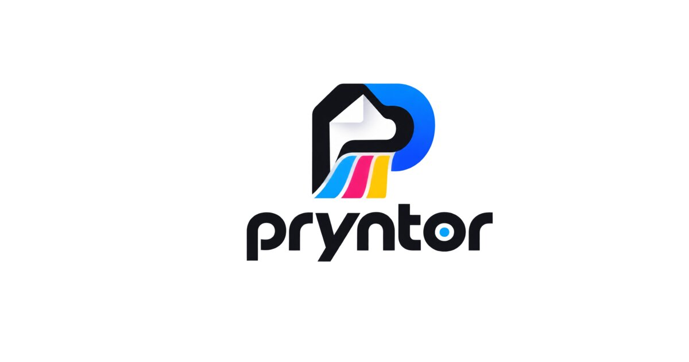

  

  # Pryntor — Campus Print App for Android

  **Upload documents straight from your phone. Laser quality printing with zero lines.**

  
  
  
  

   

  

  
Direct APK download from GitHub Releases &bull; Safe, verified build

---

## 🚀 About Pryntor

**Pryntor** is the campus printing platform built for college students. Never wait in Xerox lines, risk pen-drive viruses, or deal with paper jams again. Upload your assignment, lab manual, study notes, or project report directly from your Android phone, customize your print configuration in real-time, pay via UPI, and pick up ready prints at the campus desk.

 

  

---

## ✨ Key Features

- **⚡ Instant Price Calculator**:
  - Live campus print rates with real-time dynamic pricing.
  - Toggle between **Black & White** and **Full Color Laser** prints.
  - Support for **Single-Sided** and **Double-Sided (Duplex)** paper saving modes.
  - Automatic comparison showing how much you save versus outside commercial shops.

- **📄 Document Upload & Custom Range Support**:
  - Upload PDF, DOCX, DOC, or image files straight from phone storage or Google Drive.
  - Multi-file support with independent print configurations.
  - Advanced page selection (e.g. `1-5, 8, 12-15` or `all`) with immediate page count detection.

- **💳 Convenient Payments**:
  - Instant UPI payments (Google Pay, PhonePe, Paytm, BHIM) via QR or Razorpay.
  - Cash / UPI on Delivery (COD) supported.

- **📍 Real-Time Order Tracking**:
  - 5-stage live status pipeline:
    1. `Order Placed` (Pending)
    2. `Accepted` (Desk verified)
    3. `Printing` (On machine)
    4. `Ready for Pickup` (Desk ready)
    5. `Delivered` (Collected)
  - Search any past order via Order ID with full receipt and breakdown.

- **🔔 Campus Notifications**:
  - Real-time updates notify you the moment your print job is queued, printed, and ready at the desk.

- **🌓 Sleek Modern UI**:
  - Crafted with rich typography, glassmorphism accents, and automatic Dark / Light mode.

---

## 📲 How to Install the APK on Android

Installing the Pryntor APK takes less than a minute. Follow these steps:

### Step 1: Download the APK
Click the button below to download the latest release:
👉 **[Download pryntor-release.apk](https://github.com/gaurav87565/pryntor/releases/latest/download/pryntor-release.apk)**

### Step 2: Open the Downloaded File
Once the download finishes, swipe down your notification tray and tap **`pryntor-release.apk`**, or locate it in your phone's **Files / Downloads** app.

### Step 3: Allow Unknown Apps (First-Time Only)
If Android shows a security prompt stating:
> *"For your security, your phone is not allowed to install unknown apps from this source."*

1. Tap **Settings** on the prompt.
2. Turn ON **"Allow from this source"** (for Chrome, Files, or whichever browser you used).
3. Press **Back** and tap **Install**.

### Step 4: Google Play Protect Prompt
Because Pryntor is distributed directly on GitHub and not through the Play Store:
- If a Google Play Protect warning appears, tap **"More details"** and select **"Install anyway"**.
- The APK is 100% clean, built directly from source with zero telemetry or third-party trackers.

### Step 5: Launch & Print!
Open **Pryntor**, pick your document, and print without the Xerox line! 🎉

---

## ⚙️ System Specifications

| Specification | Details |
|---|---|
| **App Name** | Pryntor |
| **Package ID** | `me.pryntor.app` |
| **Latest Version** | `v1.0.2` |
| **Minimum OS** | Android 8.0 (Oreo / API 26) or higher |
| **Target OS** | Android 14 / 15 (API 34/35) |
| **File Format** | Android Package (`.apk`) |
| **Architectures** | Universal (ARM64-v8a, ARMeabi-v7a, x86_64) |
| **File Size** | ~97 MB |

---

## 🔒 Permissions Explained

Pryntor only requests permissions that are strictly necessary to process and print your files:

| Permission | Purpose |
|---|---|
| `READ_EXTERNAL_STORAGE` / `READ_MEDIA_*` | Selecting and uploading PDF/DOCX/image files you choose to print. |
| `POST_NOTIFICATIONS` | Receiving alerts when your order moves to *Printing* or *Ready for Pickup*. |
| `INTERNET` / `ACCESS_NETWORK_STATE` | Connecting securely with the campus print server and payment gateway. |

---

## 🌐 Official Links

- **Web App**: [https://www.pryntor.me](https://www.pryntor.me)
- **Releases Archive**: [GitHub Releases](https://github.com/gaurav87565/pryntor/releases)
- **Order Tracking**: [Track Order Status](https://www.pryntor.me/order-tracking)

---

## 📄 License & Ownership

Developed with ❤️ for the student community.  
Licensed under the [MIT License](LICENSE).
